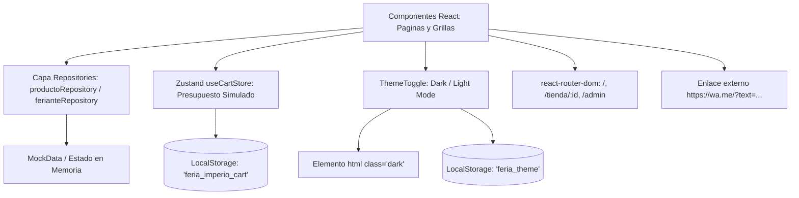

# Arquitectura del Sistema - Feria Imperio

## 1. Stack Tecnológico (Detectado en el Repositorio)
- **HTML5**: Estructura semántica en `index.html` (viewport mobile, `Plus Jakarta Sans` y Material Symbols vía Google Fonts, `class="scroll-smooth"`).
- **Framework CSS**: **TailwindCSS v3** (`^3.4.17`) con PostCSS (`^8.5.2`) y Autoprefixer (`^10.4.20`).
  - *Bootstrap*: **NO se utiliza** (no hay dependencias ni estilos de Bootstrap en el proyecto).
  - *Vanilla CSS*: Estilos base mínimos en `src/index.css` (`@tailwind base/components/utilities`, `@layer base` para tipografía/overflow, y `.scroll-section`).
  - *Tokens de diseño*: Paleta extendida en `tailwind.config.js` (`terracotta`, `forest`, `sand`, `charcoal`, `whatsapp`, y mapeo `primary`/`secondary`/`surface`).
  - *Modo Oscuro*: Estrategia por clase (`darkMode: "class"`).
- **Frontend Core**: React 18 (`18.3.1`) + TypeScript (`5.7.3`) + Vite (`6.1.0`).
- **Enrutamiento**: `react-router-dom` (`^7.18.4`) para navegación cliente (SPA).
- **Estado Global**: Zustand (`^5.0.3`) con middleware `persist` en `localStorage`.
- **Iconografía**: `lucide-react` (`^0.475.0`).
- **Patrón Arquitectural**: Patrón Repository para aislar la obtención de datos de la capa visual.

---

## 2. Mapa Real de Carpetas y Archivos
```
/ (Raíz)
├── index.html                  # Plantilla HTML5 principal
├── package.json                # Dependencias y scripts (dev, build, preview)
├── vite.config.ts              # Configuración de Vite con plugin React
├── tailwind.config.js          # Tokens de marca, darkMode 'class' y extensiones
├── postcss.config.js           # Plugins de PostCSS (tailwindcss, autoprefixer)
├── tsconfig.json               # Configuración TypeScript strict
├── GEMINI.md                   # Configuración y contexto vivo para el agente
├── docs/contexto/              # Documentación viva (6 archivos Gentle-AI)
├── .agents/rules/              # Reglas globales permanentes (antigravity_global_rules.md)
├── DetalleTienda.jsx           # Prototipo visual estático (legado)
├── Index.jsx                   # Prototipo visual estático (legado)
├── PanelAdmin.jsx              # Prototipo visual estático (legado)
├── detalle_tienda.html         # Maqueta HTML estática (legado)
├── legacy_index.html           # Maqueta HTML estática (legado)
├── panel_admin.html            # Maqueta HTML estática (legado)
└── src/                        # Código fuente modular de la aplicación React + TS
    ├── main.tsx                # Bootstrap de React con ReactDOM
    ├── App.tsx                 # Enrutador principal, layout global y toasts
    ├── index.css               # Directivas Tailwind y reglas base
    ├── types/index.ts          # Tipos e interfaces de dominio (Feriante, Producto, UIStatus)
    ├── data/mockData.ts        # Datos iniciales tipados de puestos y productos de Río Cuarto
    ├── utils/formatters.ts     # Formateadores (moneda ARS, enlaces wa.me)
    ├── store/useCartStore.ts   # Store Zustand del presupuesto simulado (localStorage)
    ├── repositories/           # Capa de abstracción de datos
    │   ├── index.ts            # Exportación de instancias activas
    │   ├── interfaces/         # Contratos (IFerianteRepository, IProductoRepository, etc.)
    │   └── mock/               # Implementaciones simuladas asíncronas
    ├── components/             # Componentes de interfaz ordenados por función
    │   ├── layout/             # NavBar, Footer, HeroBanner
    │   ├── stores/             # StoreCard, StoreGrid (con 4 estados)
    │   ├── catalog/            # CategoryFilter, ProductCard, ProductGrid, ProductModal
    │   ├── ferias/             # FeriasSection (Paseo del Andino / Parque Sarmiento)
    │   ├── contact/            # ContactForm (postulación de feriantes)
    │   ├── cart/               # CartDrawer (cajón de presupuesto)
    │   └── common/             # ThemeToggle, Toast, FloatingWhatsApp
    └── pages/                  # Vistas completas asociadas a rutas
        ├── HomePage.tsx        # Portada y directorio general ('/')
        ├── StoreDetailPage.tsx # Ficha y catálogo individual ('/tienda/:id')
        └── AdminPage.tsx       # Gestión de stock y precios ('/admin')
```

---

## 3. Flujo de Datos


---

## 4. Qué NO Existe en el Repositorio (Límites Observados)
- [PENDIENTE: Servidor backend propio / API REST remota]: La app funciona 100% en el cliente con repositorios mock y demoras simuladas.
- [PENDIENTE: Base de datos SQL/NoSQL remota]: No existe conexión a PostgreSQL, MySQL, Mongo ni Firebase.
- [PENDIENTE: Pasarelas de pago online]: No hay integración con Mercado Pago, Stripe ni checkout bancario. Las transacciones se coordinan por WhatsApp.
- [PENDIENTE: Autenticación / Login de usuarios]: El acceso a `/admin` es directo sin credenciales, tokens JWT ni sesiones.
- [PENDIENTE: Archivo README.md]: No existe actualmente documentación en `README.md` en la raíz.
- [PENDIENTE: Suite de pruebas automatizadas]: No hay tests configurados (Vitest, Jest o Playwright ausentes en `package.json`).
