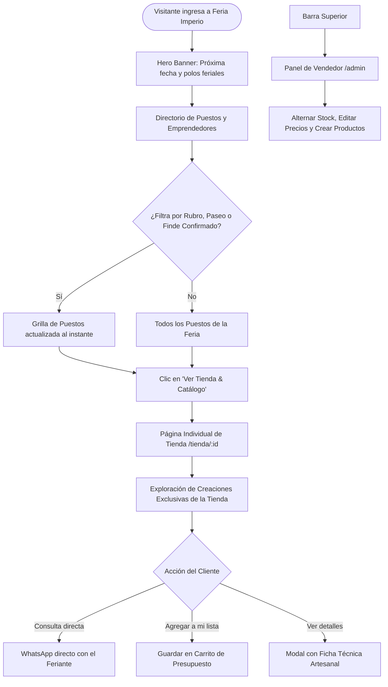

# Flujos de Usuario y Casos de Uso - Feria Imperio

## 1. Flujos Principales de Usuario

### 1.1 Flujo A: Exploración de Directorio y Visita a Tienda de Emprendedor
1. El usuario ingresa a la portada (`/`) y consulta los puestos feriales activos.
2. Filtra por **Rubro** (*Artesanías, Cerámica, Gastronomía, Marroquinería, Madera, Indumentaria*) o por **Paseo** (*Paseo del Andino* o *Parque Sarmiento*), o activa la casilla de **Finde Confirmado**.
3. Al seleccionar una tienda, navega a la URL dedicada `/tienda/:id` (ej: `/tienda/fer-01`).
4. En la página de la tienda, visualiza la bio del artesano, ubicación exacta del gazebo y el catálogo exclusivo de ese puesto.
5. Puede consultar disponibilidad directamente por WhatsApp o agregar artículos a su lista de presupuesto.

### 1.2 Flujo B: Autenticación de Feriantes y Gestión de Mi Taller (`/admin`)
1. El artesano hace clic en el botón *"Iniciar Sesión"* en la barra de navegación.
2. Se abre el **Modal Integrado de Ingreso** (`LoginModal`), donde puede:
   - Iniciar sesión con su nombre de puesto/responsable y contraseña (`feria123`).
   - O utilizar el **Acceso Rápido de Demostración** (1 click sobre su avatar).
3. Una vez autenticado:
   - La barra de navegación muestra su avatar, el nombre de su puesto y el badge pulsante *"Puesto Activo"*.
   - El menú desplegable le permite ir directo a *"Mi Taller"*, *"Ver Mi Puesto Público"* o *"Cerrar Sesión"*.
   - Es redirigido automáticamente a su panel de gestión en `/admin`.
4. Si un usuario no autenticado ingresa a `/admin`, el sistema muestra un estado protegido amigable invitándolo a iniciar sesión.
5. Dentro de su taller, el feriante gestiona su propio inventario en tiempo real: alternar stock, editar precios en vivo y dar de alta nuevas piezas artesanales.

### 1.3 Flujo C: Postulación o Contacto Ferial
1. El artesano o visitante completa el formulario en la portada (Nombre, Emprendimiento, WhatsApp, Rubro y Mensaje).
2. El sistema valida los datos y muestra un Toast feedback exitoso confirmando la recepción.

### 1.4 Flujo D: Autenticación de Usuario Comprador (Vecino de Río Cuarto)
1. El visitante hace clic en *"Iniciar Sesión"* en la barra de navegación superior.
2. Selecciona la pestaña **[Soy Comprador]** (Portal Vecinos).
3. Puede ingresar su nombre/correo y contraseña (`comprador123`) o seleccionar un perfil de comprador demo con 1 click (María Gómez, Lucas Rossi o Valentina Torres).
4. Al ingresar:
   - La barra de navegación centraliza la búsqueda y muestra su avatar con el badge *"Comprador Ferial"*.
   - El menú de usuario le permite abrir directamente *"Mi Lista de Compras"*, *"Explorar Puestos y Ferias"* o *"Cerrar Sesión"*.
   - Los pedidos enviados a los artesanos por WhatsApp personalizan el saludo con el nombre del comprador conectado.

---

## 2. Checklist de Verificación y Criterios de Aceptación (DoD)

Para considerar cada vista o componente terminado, se valida explícitamente el cumplimiento de los **4 Estados de UI**:

| Estado de UI | Comportamiento Requerido en Directorio y Tiendas |
|---|---|
| ⏳ **Loading** | *Skeleton loaders* con pulsación suave tanto en la grilla de tiendas como en la vista de detalle. |
| 📭 **Empty** | Si un filtro no arroja resultados, mostrar icono de tienda, mensaje empático y botón para restablecer filtros. |
| ❌ **Error** | Mensaje amigable con botón de reintento en el directorio o botón para volver al directorio si no se encuentra la tienda (`/tienda/:id`). |
| ✅ **Success** | Renderizado fluido con fotos de alta resolución, banners, enlaces funcionales a WhatsApp y badges feriales. |
